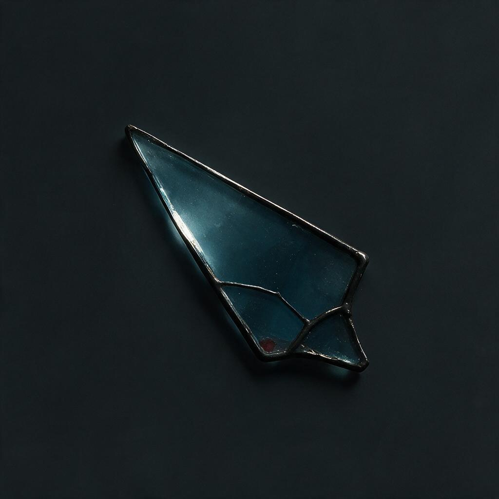

# Витражи — направление для художественных проб

2026-11-03. Решение владельца: понравился курсор-осколок витража. Нужно попробовать иконки навыков как витражи и уделить витражам внимание в интерьерах башенного мира, возможно — в задниках интерфейса.

## Главный референс

[Осколок витража — оригинал Venice](cursor/2026-11-03-venice-358/glass.png).

Происхождение: Venice seedream-v5-pro-edit, промпт и параметры рядом с оригиналом. [Прозрачная производная для курсора](cursor/2026-11-03-venice-358/cutouts/glass.png) немного ярче и синее исходника; [игровой PNG](../../game/Ui/Art/Cursors/glass.png) — 48×48. Для формы, материала и света сохраняем оба изображения, не выдаём производную за точную копию оригинала.

## Что исследовать

- **Иконки навыков:** смысловой рисунок из цветного стекла и металлических переплётов, свет через стекло, ясный внешний силуэт. У каждого навыка и узла остаётся собственный сюжет; общий осколок или одна перекрашенная форма не заменяют индивидуальные иконки.
- **Интерьеры:** витражные окна и их фрагменты как часть архитектуры башни, взаимодействие стекла и света. Оценить на реальной игровой камере, сохраняя читаемость персонажей и боя.
- **Задники:** попробовать отдельные композиции с витражами, если они поддерживают тему окна и оставляют спокойную область под текст. Не превращать все задники в один повторяющийся мотив.

Особенно интересуют дымчатое холодное стекло, его глубина и светопропускание, тёмная металлическая оправа, асимметрия осколка и небольшие цветовые включения. Сверять с ART_DIRECTION.md: основной свет остаётся сдержанным, цветовые акценты не становятся общей насыщенной заливкой или постоянным bloom.

Статус: **направление для проб, не поручение массово заменить готовые иконки и задники**. Для иконок проверить 64/32/24px и настоящий UI; для интерьеров — сцену в движении. Концепты и задники создавать через Venice, иконки развивать через GPT от выбранных оригиналов по действующему skill.
