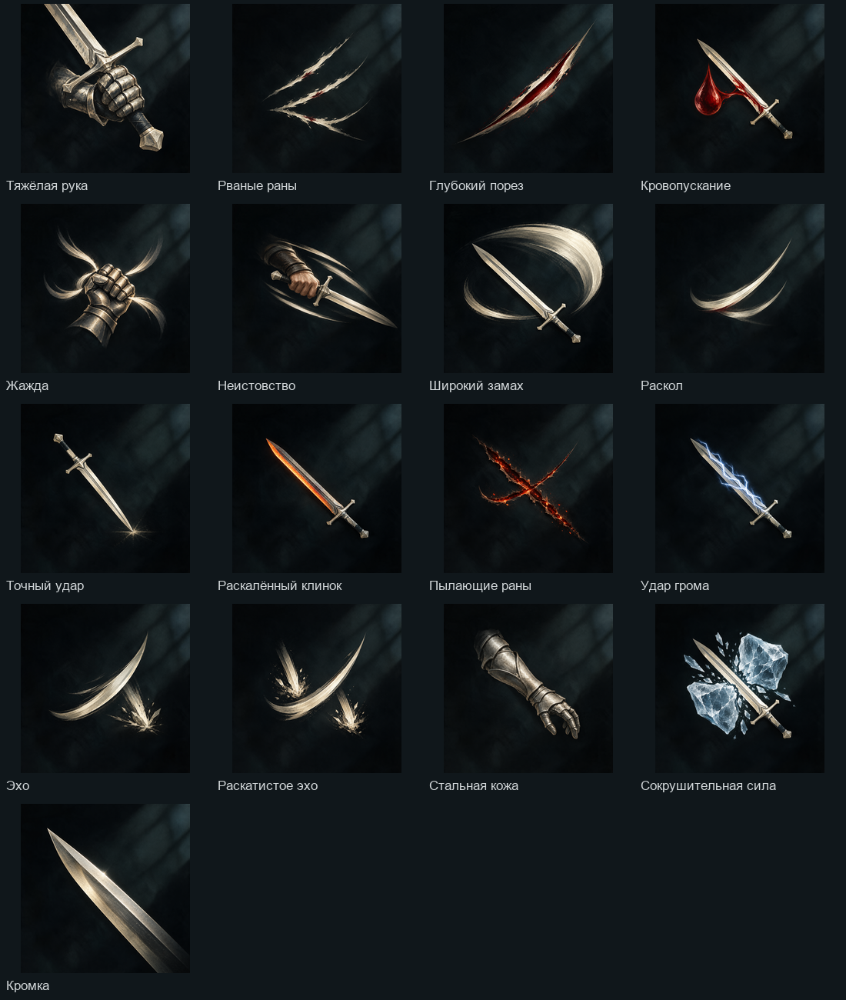

# Иконки 17 узлов Рассекающего удара

Сгенерированы встроенным GPT image_gen по поручению владельца «сгенерь». Каждый узел получен отдельным запросом от одного утверждённого Venice-оригинала `../2026-10-31-venice-tower-icons/cleave.png`; последовательных перерисовок результатов нет.

Имена PNG совпадают с node_id дерева cleave. Исходные полные изображения сохранены без изменений. `manifest.json` содержит соответствие, исходный путь генерации, промпт и общий референс. Рамки, числа и состояния не запечены.

Листы проверки: [64 px](review-64px.png), [32 px](review-32px.png), [24 px](review-24px.png). Визуально просмотрены общий лист, 32 и 24 px. Близкие варианты различаются формой и количеством следов; небольшие цветовые акценты на минимальном размере вторичны. Окончательная проверка на фоне реального дерева K остаётся при подключении. Комплект не подключён в runtime и не заменяет существующие ассеты.

`preview.py` воспроизводит обзорные листы из оригиналов, не меняя PNG узлов.

## Подключение

По следующему поручению владельца «так обнови» все 17 иконок подключены через GameIcons.SkillNode и SkillsPanel. Runtime PNG: game/Ui/Art/Icons/skill_nodes/cleave/, 64 px; в строках окна K — 32 px. Это обновление существующего списка, радиальная раскладка остаётся отдельной работой. Сборка: 0 предупреждений/ошибок. CleaveIconsPreview подтвердил 17 различных текстур и открыл настоящее окно K; [кадр](in-game.png). Предыдущее замечание о неподключённом комплекте описывает этап генерации и теперь заменено этим разделом.

Последующее поручение «реализуй» выполнено: теперь узлы показаны графом, а не списком. По обратной связи о жёлтых кругах используется отдельная отрисовка с заполненными квадратными иконками, тонкой холодной рамкой и тёмными рангами. [Актуальный кадр](in-game-radial-art.png); арт-ревью APPROVE. Исторические кадры выше сохранены для сравнения.
