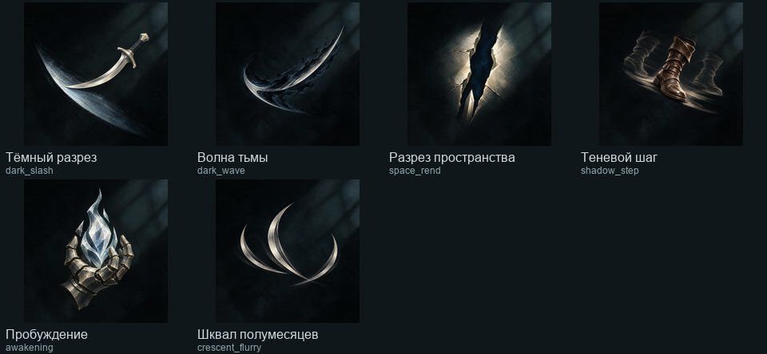

# Недостающие иконки Воителя и Отступника

197 индивидуальных изображений созданы встроенным GPT image_gen от одного утверждённого [Venice-оригинала](../2026-10-31-venice-tower-icons/cleave.png). Генерация завершена; итоговые решения арт-приёмки и runtime-проверки находятся рядом с этим файлом.

| Набор | Новые иконки навыков | Новые иконки узлов |
|---|---:|---:|
| Воитель | 0 — готовые сохранены | 87 |
| Отступник | 6 | 104 |
| Всего | 6 | 191 |

17 прежних индивидуальных узлов Cleave сохранены. Каталог ресурсов содержит 208 иконок узлов обоих классов и шесть новых иконок навыков Отступника; ссылки служебных копий используют родительскую иконку. Боевые данные и доступность классов не изменены: Отступник отсутствует в активном наборе классов, его ресурсы проверяются отдельным предпросмотром ассетов, без восстановления архивных механик.

## Просмотр

| Воитель | Отступник |
|---|---|
| [Сокрушение](review/crush-contact.png) | [Тёмный разрез](review/dark_slash-contact.png) |
| [Боевой клич](review/battle_cry-contact.png) | [Волна тьмы](review/dark_wave-contact.png) |
| [Вихрь](review/whirlwind-contact.png) | [Разрез пространства](review/space_rend-contact.png) |
| [Рывок](review/charge-contact.png) | [Теневой шаг](review/shadow_step-contact.png) |
| [Метательный топор](review/throwing_axe-contact.png) | [Пробуждение](review/awakening-contact.png) |
| | [Шквал полумесяцев](review/crescent_flurry-contact.png) |

Для каждой строки рядом сохранён лист `review/<skill_id>-sizes.png` с точными размерами 64/32/24 px. Рамки, ранги, выбранное состояние и связи рисует UI; они не запечены в картинках.

## Исходники и воспроизведение

- `warrior-briefs.json`, `apostate-briefs.json`: точные ID, описание и предметное задание каждого изображения.
- `<skill_id>/<node_id>.png` и `skills/<skill_id>.png`: мастера первичной генерации; соседний JSON содержит промпт, исходный путь результата и провайдера.
- `revisions/`: доработки по замечаниям, каждая снова от исходного Venice-оригинала. `selected-revisions.json` задаёт выбранные версии. Первые варианты сохранены для сравнения и не подменяют выбранные.
- `manifest.json`: все 197 выбранных мастеров, их размеры, контрольные суммы и runtime-пути; `missing` должен быть пустым. Встроенный инструмент не вернул точный ID модели или seed: эти значения не выдумывались.
- `export.py`: экспорт в 64 px, проверка уникальности PNG, генерация точного whitelist-каталога `GameIcons.Swordsmen.Generated.cs` и обзорных листов. По умолчанию незавершённая генерация даёт отказ; `--partial` используется только на промежуточном этапе.

Иконки Воителя подключены к настоящим деревьям. Для Отступника подключены точные ресурсные ID и алиасы служебных копий, а не новые правила боя. `SwordsmenIconsCheck.tscn` проверяет точные пути, размер 64×64 и защиту от неизвестных ID; с `--swordsmen-shots` снимает шесть деревьев Воителя и все ресурсные листы обоих классов.

## Приёмка

`review-warrior.json` — независимая проверка пяти новых семейств Воителя; `review-apostate.json` — шесть навыков и первые три семейства Отступника; `review-apostate-late.json` — последние три семейства. Проверяются конкретный смысл, различимость и соответствие утверждённому стилю, а не возможность прочитать точные проценты по рисунку. Итоговая техническая проверка фиксируется в `runtime-final.log` и каталоге `in-game/`.

Итог: все 197 новых изображений APPROVE; 14 выбранных ревизий закрыли замечания к силуэтам, читаемости и ошибочному огненному акценту. Независимое CODE-ревью каталога и экспортера — APPROVE. Финальная сборка — 0 ошибок/предупреждений; Godot проверил все 214 текстур, точные пути, размер и отказ неизвестным ID. Целевой skills selftest — 6/6 PASS; полный общий selftest не выполнялся.

Реальные кадры: [дерево Сокрушения](in-game/warrior-tree-crush.png), [дерево Вихря](in-game/warrior-tree-whirlwind.png), [шесть иконок Отступника](in-game/apostate-skills.png), [узлы Пробуждения](in-game/nodes-awakening.png). Остальные деревья и ресурсные листы сохранены в том же каталоге.
