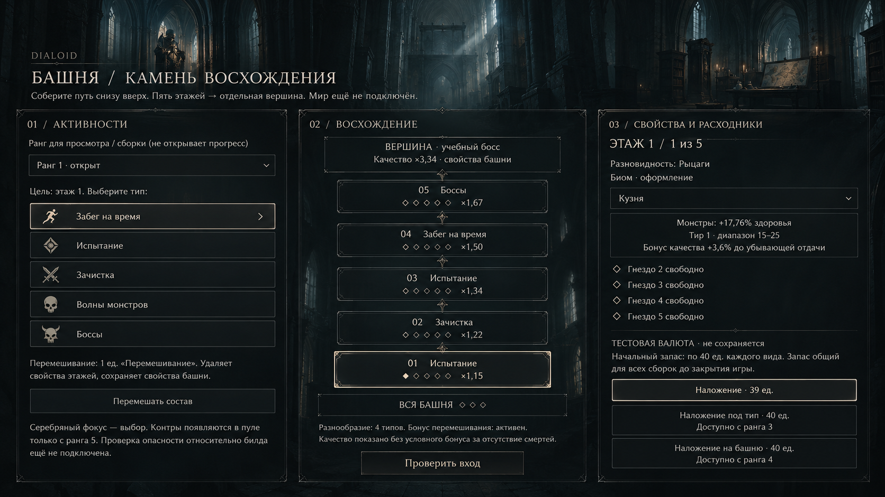
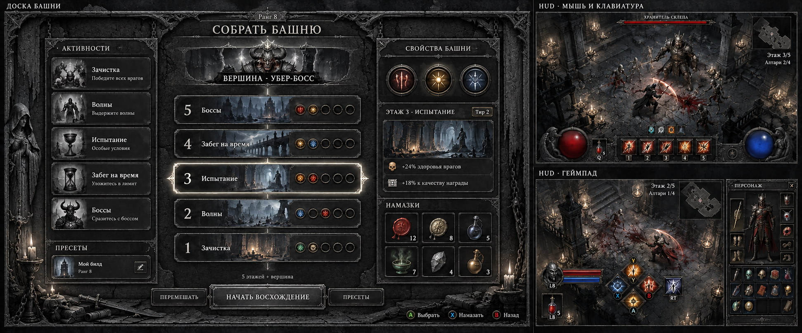
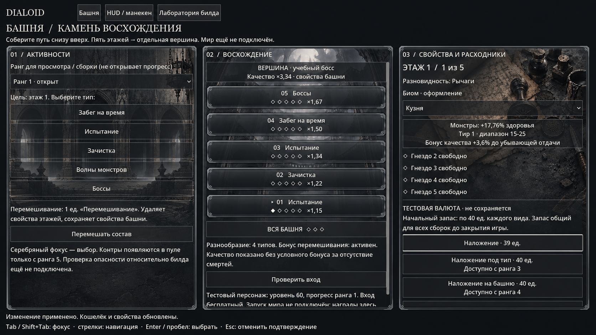

# Визуальное направление доски башни

## Рабочий экран — 2026-11-01

Доска снова подключена в текущей игре: кнопка **Башня F6** в верхней панели или **F6**. Закрытие: Esc, F6, B на геймпаде либо кнопка «Закрыть». Реализация: `game/Ui/Tower/TowerBoardView.cs`; интеграция: `game/Main.Tower.cs`. Можно собирать этажи, выбирать ранг/биом и применять расходники через Core. Тестовый кошелёк не сохраняется. Каталога убер-боссов и игровых 3D-этажей пока нет; проверка входа не запускает забег и не выдаёт награды.

Настоящие кадры: [обычный размер](2026-11-01-runtime/tower-board.png), [1280×720](2026-11-01-runtime/tower-board-720.png). Ниже сохранена история макетов и прежних ограничений.

## Актуальное направление — 2026-10-31

Текущий стандарт: [ART_DIRECTION.md](../ART_DIRECTION.md). Он заменяет раннюю трактовку интерфейса как сплошной фактуры серого камня. Архитектурная глубина, холодный рассеянный свет из высоких окон, мягкие тени, угольные поверхности и тонкие тёмные границы. Светлый текст и выделение слоновой костью; без универсальных золотых рамок, зерна и сколов.

Это художественный макет, созданный встроенным imagegen на основе исторического скриншота и утверждённых эталонов Venice. Не runtime-кадр. Три колонки, пять этажей, отдельная вершина и операции валюты сохранены как визуальная структура; текст и значки внутри генерации не заменяют реальные элементы UI. Сам экран башни в текущем checkout отсутствует, поэтому интеграция и проверка в движке не выполнены.

Новые отдельные фоны: `game/Ui/Art/TowerPanels/*-v2.png`. Исходные v1 сохранены как история. Ниже — прежнее направление и исторические проверки.

2026-10-31. Владелец предпочел вариант с серым камнем: «да, это мне больше нравится».

## Выбранное направление

- Основной материал — серый камень; детали — темное железо.
- Текст светлый; подсветка выбора — слоновая кость/серебро.
- Цветовые акценты — свойства, расходники, здоровье и ресурс.
- За основу принят серый вариант вместо бронзово-золотого с красным декором.

## Тематические задники трех панелей

2026-10-31: по запросу владельца подготовлены отдельные изображения для активностей (арочные входы), восхождения (башня изнутри) и свойств/расходников (стол с картой и печатями).

Это сгенерированное художественное превью на основе сохраненного runtime-кадра, а не новый скриншот движка. Три исходных PNG 1024×1536, промпты и правила подключения сохранены в [пакете TowerPanels](../../../game/Ui/Art/TowerPanels/README.md). В текущей рабочей версии исходник самой доски отсутствует, поэтому автоматическое подключение к нему не выполнено. Историческая приемка экранов ниже описывает прежнюю рабочую версию.

Это выбор художественного направления. Точная компоновка, управление, размеры и тексты еще требуют проработки; изображение не утверждает все изображенные механики и привязки кнопок. В частности, HUD должен соблюдать утвержденную спеку боя, даже если генерация изображения допустила расхождения.

Изображение создано встроенным imagegen как редакция первого концепта: сохранена композиция доски с пятью этажами и отдельной вершиной, свойства 5/3, боковые панели и два вида HUD; материалы заменены на холодный серый гранит и темное железо, золотая подсветка — на светлую. Ассет служит визуальным референсом, а не готовой текстурой интерфейса.

## Реализация экранов

Основная сцена предоставляет три входа: «Башня», «HUD / манекен», «Лаборатория билда». Доска — стартовый экран обычного запуска. Лаборатория сохраняет текущую сессию и семь вкладок.

На доске работают сборка типов и биомов, перемешивание, выбор цели этажа/башни и операции валюты через существующие правила ядра. Кошелек явно тестовый; он не записывается в прогресс. «Проверить вход» проверяет правила ранга и состава; это не запуск готового 3D-мира.

HUD использует живой `TrainingRoom` и тот же билд, что лаборатория. Для проверки навыков загрузить эталонный билд на вкладке «Билды» и вернуться в HUD. Клавиши 1–5 и кнопки геймпада запускают реальные навыки против манекена. Каналы удерживаются, перезарядки и ресурс приходят из ядра. Геймпад переключает HUD на угловой вид, мышь/клавиатура — на классический.

Серые рамки и подложки — настоящие ресурсы Godot. Зелье, инвентарь предметов, подбор и прогресс активностей не получают фиктивной реализации: для них нужны адаптеры последующих планов.

План и приемка: [tower-board-hud-ui](../../superpowers/plans/2026-10-31-tower-board-hud-ui.md). Проверка в движке запускается аргументом `--tower-ui-selftest`; `--ui-screenshots <каталог>` дополнительно сохраняет доску и два вида HUD.

### Приемка 2026-10-31

Сборка Godot C# без ошибок и предупреждений. `TOWER_UI_PASSED`: подтверждения и расход валюты, реальные события ЛКМ/ПКМ, изоляция меню от боя, оба вида HUD, прокрутка фокуса боковых панелей на 720p, выбор узлов дерева и остановка скрытого манекена. Доска прошла техническое ревью; блокеры UI- и технического ревью HUD исправлены и перепроверены. Управление геймпадом проверено обработчиками и событиями движка; физическое устройство в этой приемке не использовалось.

Кадры из работающего Godot:

- [Доска](runtime/tower-board.png)
- [HUD с мышью](runtime/hud-mouse.png)
- [HUD с геймпадом](runtime/hud-controller.png)
- [Боковые панели и выбранный узел на 720p](runtime/hud-panels-720.png)

Деревья: крестовина/LS выбирают узел, A берет или снимает, X открывает выбор атрибута, LT/RT меняют масштаб, R3 вписывает дерево. View переносит фокус между панелями и боем; удержание открывает эффекты. Описание выбранного узла закреплено над прокруткой.
