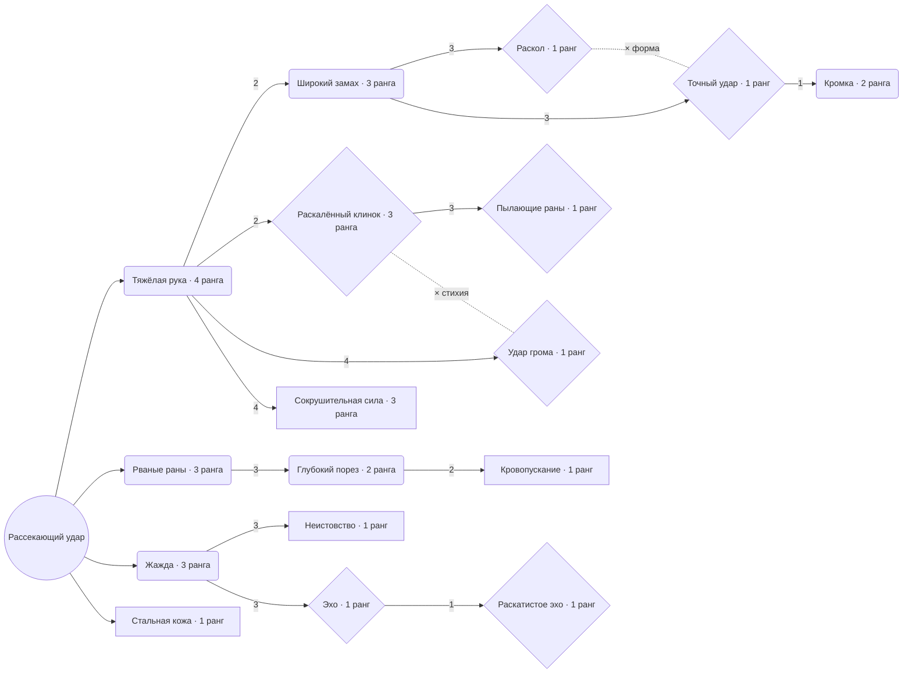

# Рассекающий удар — обновлённое дерево навыка

Подготовленная схема для окна K. В центре — сам навык, вокруг — ветви развития. Все 17 узлов, ранги, требования и взаимоисключения сохранены из `data/skills.json`. Это схема будущего представления; игровой интерфейс пока не изменён. Восхождения рассматриваются отдельно.

## Схема связей

Круглые скобки — усиление, фигурные — преобразование, квадратные — условная механика. Число на стрелке означает необходимое количество вложений в предыдущий узел. Линия от центра означает отсутствие требований к другим узлам, а не дополнительную стоимость. Пунктир с × обозначает взаимоисключение, а не переход.

Диаграмма показывает зависимости. В радиальной раскладке центр остаётся общим: сверху форма удара, справа стихии, снизу кровотечение, слева ресурс и темп. Стальная кожа — короткая самостоятельная ветка у центра. Тяжёлая рука остаётся общим входом формы и стихий; нельзя рисовать два независимых экземпляра с отдельными очками.

## Что игрок получает

| Ветка | Узел | Эффект за ранг или при выборе |
|---|---|---|
| Общий вход | Тяжёлая рука, 4 | +8% increased урона |
| Форма | Широкий замах, 3 | +20% площади |
| Форма | **Раскол**, 1 | Второй удар — триггерная копия с 50% урона; без дополнительной генерации ресурса и цепочки проков |
| Форма | **Точный удар**, 1 | Убирает площадь, +50% More урона, +5 п.п. шанса крита; исключает Раскол |
| Форма | Кромка, 2 | +15 п.п. критического урона |
| Стихии | **Раскалённый клинок**, 3 | По 20% физического → огонь, до 60%; уже первый ранг исключает Удар грома |
| Стихии | **Пылающие раны**, 1 | Связывает шанс кровотечения с шансом поджога; кровотечение сохраняется. В данных: +10 п.п. ignite_chance и +1 за каждый пункт bleed_chance |
| Стихии | **Удар грома**, 1 | 50% физического → молния, +20 п.п. шанса шока; исключает Раскалённый клинок |
| Условный урон | Сокрушительная сила, 3 | +10% increased урона по замороженным целям; оглушение не является условием |
| Кровотечение | Рваные раны, 3 | +10 п.п. шанса кровотечения |
| Кровотечение | Глубокий порез, 2 | +20% increased урона кровотечения |
| Кровотечение | Кровопускание, 1 | +4 к генерации ресурса, если основная цель уже кровоточит |
| Ресурс и темп | Жажда, 3 | +2 к генерации ресурса |
| Ресурс и темп | Неистовство, 1 | Каждое третье применение: +15% increased скорости атаки на 3 с; обновление без накопления |
| Ресурс и темп | **Эхо**, 1 | Каждое четвёртое применение запускает копию Сокрушения с 30% урона |
| Ресурс и темп | **Раскатистое эхо**, 1 | На том же четвёртом применении запускается вторая копия Сокрушения с 30% урона; две копии, отдельные броски недугов |
| Защита | Стальная кожа, 1 | Попадание даёт +80 брони на 4 с |

## Как читать дерево в окне K

- Малые круглые узлы показывают ранги `0/4`, `2/3` и краткий эффект. Преобразующие узлы крупнее, с собственной формой рамки: отличие читается без цвета. Многоранговый Раскалённый клинок остаётся преобразованием.
- Выбранный узел открывает постоянную панель: изменение навыка, текущий и следующий ранг, требования, взаимоисключающая альтернатива, вложить/снять очко. Подсказка доступна фокусом клавиатуры и геймпада.
- Все узлы видны с начала. Недоступный узел остаётся читаемым; панель объясняет, чего не хватает, например «Тяжёлая рука: 2/4, нужно 4».
- Альтернативы формы и стихии соединены отдельной связью с символом ×. Другие ветви можно сочетать в пределах общего бюджета; сектора не являются отдельными специализациями.
- Каждое вложение расходует одно очко общего бюджета навыка. Размер рамки и расстояние от центра не добавляют цену. Центр не требует покупки.
- При снятии ранга действует существующая проверка зависимостей; схема не обещает автоматический сброс дочерних узлов или бесплатную смену формы.

## Иконка каждого узла

Требование владельца: каждый из 17 узлов получает собственную смысловую иконку. Это относится и к ранговым усилениям, и к преобразованиям, и к условным механикам. Центральный навык использует свою существующую иконку Рассекающего удара. Одна иконка узла сохраняется на всех его рангах; количество вложений показывает интерфейс.

По заданиям ниже сгенерирован [комплект из 17 иконок](../../art/icons/2026-10-31-cleave-nodes/README.md); в игровой интерфейс он пока не подключён. Идентификатор пары `cleave/<node_id>` однозначно связывает картинку с узлом; это соглашение для каталога, не новое поле боевого JSON.

| node_id | Узел | Образ иконки |
|---|---|---|
| `heavy_hand` | Тяжёлая рука | Массивная рука в латной перчатке сжимает рукоять; акцент на тяжести хвата |
| `lacerate` | Рваные раны | Три расходящихся неглубоких рваных пореза, небольшой тёмно-красный акцент |
| `deep_cut` | Глубокий порез | Один широкий глубокий разрез; чётко отличается от трёх порезов Рваных ран |
| `bloodletting` | Кровопускание | Крупная капля у клинка с направленным внутрь рукояти потоком; получение ресурса от кровотечения, без символа лечения |
| `thirst` | Жажда | Сжатый кулак и сходящиеся к нему короткие потоки силы; без чаши или капли здоровья |
| `frenzy` | Неистовство | Рука с оружием в резком движении, несколько коротких следов ускорения |
| `wide_swing` | Широкий замах | Один широкий веер дуги клинка; читается увеличение охвата |
| `split` | Раскол | Два последовательных рубящих следа, второй короче и слабее; без разлетающихся снарядов |
| `precise_strike` | Точный удар | Один клинок направлен в маленькую точку цели; узкий акцент вместо веера площади |
| `searing_blade` | Раскалённый клинок | Стальной клинок с локально раскалённой оранжевой кромкой; металл остаётся различимым |
| `burning_wounds` | Пылающие раны | Рваный порез с несколькими углями внутри; отличается от изображения огненного оружия |
| `thunder_strike` | Удар грома | Клинок с одной ломаной холодной электрической ветвью вдоль лезвия |
| `echo` | Эхо | Основной рубящий след и один меньший нисходящий удар Сокрушения рядом |
| `rolling_echo` | Раскатистое эхо | Та же композиционная основа Эха, но два отдельных малых нисходящих удара |
| `steel_skin` | Стальная кожа | Предплечье с металлическими пластинами поверх кожи; без отдельного щита |
| `crushing_force` | Сокрушительная сила | Лезвие разбивает крупный фрагмент льда; заморозка, без символов оглушения |
| `edge` | Кромка | Крупный фрагмент остро заточенного лезвия с небольшим точечным бликом |

Общая манера — из актуального `docs/art/ART_DIRECTION.md`: крупная светлая форма на глубоком тёмном фоне, сдержанный цветовой акцент, без общего свечения. Числа, подписи, рамки, замки и состояние доступности не запекать в изображение. Тип узла определяется рамкой интерфейса, а не заменяет индивидуальную иконку.

Производство: GPT по утверждённому оригиналу семейства, согласно `.agents/skills/dialoid-venice/SKILL.md`; новый концепт семейства при необходимости создаётся через Venice. Сохранить исходник, промпт и соответствие node_id. Проверить все 17 иконок вместе в 64, 32 и 24 px, особенно пары Рваные раны/Глубокий порез, Широкий замах/Раскол, Эхо/Раскатистое эхо. Если мелкие детали сливаются, упростить силуэт.

Критерий готовности: у каждого узла есть назначенный и проверенный ассет; общий символ типа, заглушка или иконка самого навыка не считаются готовой иконкой узла. Подготовка этой таблицы не означает завершения генерации и подключения.

## Существенные ограничения

Точный удар требует три ранга Широкого замаха, хотя затем убирает площадь. В текущем дереве это реальная цена пути: показать предупреждение «После выбора бонус площади не работает для этого удара». Перенос требований — отдельное решение по балансу, здесь он не предложен.

Эхо связано с деревом Сокрушения: итоговый результат зависит от его присутствия в слоте и действующих правил триггеров. Взаимодействия с Цепным ударом, конверсиями и Кровавым договором должны объясняться итоговыми свойствами навыка; фиксированная подпись «Ярость» не заменяет актуальную ресурсную подсказку.

## Перед переносом в игру

Проверить обнаруживаемость пяти ключевых преобразований: Раскол, Точный удар, Раскалённый клинок, Удар грома, Эхо. Сверить 17 узлов и все связи с данными, общий бюджет и запреты выбора. Проверить читаемость на реальном экране K, навигацию фокусом и длинные подписи. Нужны отдельные проверки поведения копий, конверсий и потери площади в тренировочной комнате.

Основа: [карточка задачи](../../tasks/TASK-skill-transform-passives.md), [данные навыков](../../../data/skills.json). Схема не вводит новых полей в JSON и не меняет боевые эффекты.
